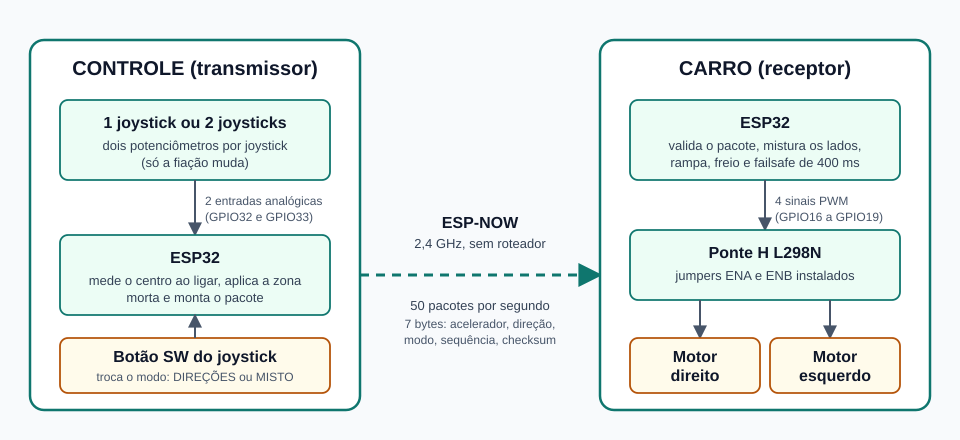

# ODIR ESP-NOW 2.0

Um carrinho de duas rodas controlado por joystick pelo ar, com duas placas **ESP32 clássicas** e o protocolo ESP-NOW. Sem roteador, sem celular, sem internet.

Projeto do **Tio Rafa** (Robótica Paula Souza / CPS), da **edição 19 da Revista Mecatrônica Jovem**: [revista-mecatronica-jovem](https://tiorafa.tec.br/revista-mecatronica-jovem/). Duas montagens de controle com **o mesmo código**: **1 joystick** (todas as direções) ou **2 joysticks** (um para frente e trás, outro para esquerda e direita).



> **Sem o kit MonTTudo? Use peças recicladas.** Papelão, acrílico ou MDF de sucata no chassi, tampinhas nas rodas, motores de brinquedo quebrado, joystick de videogame quebrado. A mecânica é flexível; a eletrônica (ESP32, L298N, GND comum, 3V3 nos joysticks) não é. Cuidado especial com baterias de lítio recicladas. Veja o [manual](docs/MANUAL.md).

## Comece por aqui

1. Leia o [manual completo](docs/MANUAL.md).
2. Monte com o [passo a passo da montagem](docs/PASSO_A_PASSO_MONTAGEM.md), a [pinagem](docs/PINAGEM.md) e a [lista de materiais](hardware/LISTA_DE_MATERIAIS.md).
3. Grave os sketches na ordem:

| Passo | Pasta | O que faz |
|---:|---|---|
| 1 | `firmware/Passo1_Descobrir_MAC` | Mostra o MAC do carro |
| 2 | `firmware/Passo2_Teste_Joystick` | Testa o(s) joystick(s) |
| 3 | `firmware/Passo3_Teste_Motores` | Testa os motores (rodas no ar) |
| 4 | `firmware/Passo4_Carro_Receptor` | Firmware do carro |
| 5 | `firmware/Passo5_Controle_Transmissor` | Firmware do controle |

Antes do Passo 5, cole o MAC do carro em `config_controle.h` (`MAC_CARRO`). Com zeros, o controle se recusa a iniciar, de propósito.

## Ligações em uma olhada

| Carro (ESP32 para L298N) | Controle (joystick para ESP32) |
|---|---|
| GPIO16 para IN1, GPIO17 para IN2 | VRy para GPIO33 (frente/trás) |
| GPIO18 para IN3, GPIO19 para IN4 | VRx para GPIO32 (esquerda/direita) |
| GND comum | SW para GPIO25 (troca de modo); joystick em **3V3**, nunca em 5V |

Detalhes e figuras no [manual](docs/MANUAL.md), seção 7, e na [pinagem](docs/PINAGEM.md).

## O que a versão 2 melhora

Dois modos de condução (DIRECOES como no vídeo, MISTO com velocidade proporcional), centro do joystick medido ao ligar, zona morta, PWM com rampa de aceleração e freio, pacote de 7 bytes validado, failsafe de 400 ms, compatível com Arduino-ESP32 2.x e 3.x. A lista completa está no [CHANGELOG](CHANGELOG.md).

## Estado de validação

| Etapa | Situação |
|---|---|
| Revisão e testes de lógica no computador (com simulação das bibliotecas do ESP32) | VALIDADO POR ANÁLISE |
| Compilação, gravação e funcionamento em placas reais | TESTADO EM HARDWARE pelo autor (Rafael Oliveira, informado em 04/11/2026) |


## Estrutura

```text
firmware/   sketches e arquivos comuns (comum/ é a fonte oficial)
docs/       manual, passo a passo, pinagem, protocolo e imagens
hardware/   lista de materiais
tools/      sincronizar_comum.sh e testes no computador
```

Ao editar algo em `firmware/comum/`, rode `bash tools/sincronizar_comum.sh` para copiar aos sketches (`--checar` só verifica).

## Créditos

Código original (versão 1): **Ujwal Nandanwar**, adaptado por **Rafael Oliveira**. Agradecimentos do projeto: Prof. Flavio Guimarães, Thiago, Renato Paiotti, Mamute Eletrônica (kit MonTTudo), canal Brincando com Ideias e Instituto NCB (Newton C. Braga). O nome ODIR homenageia o pai do professor Rafael.

## Licença

Código da versão 2: MIT (arquivo `LICENSE`). A versão 1, de Ujwal Nandanwar adaptada por Rafael Oliveira, **não está neste repositório**:


## Contato

contato@tiorafa.tec.br | Instagram @prof.tiorafa
