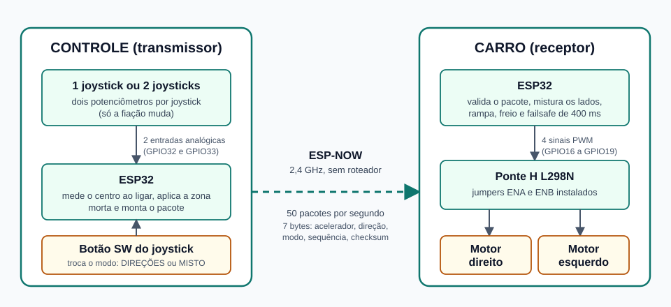
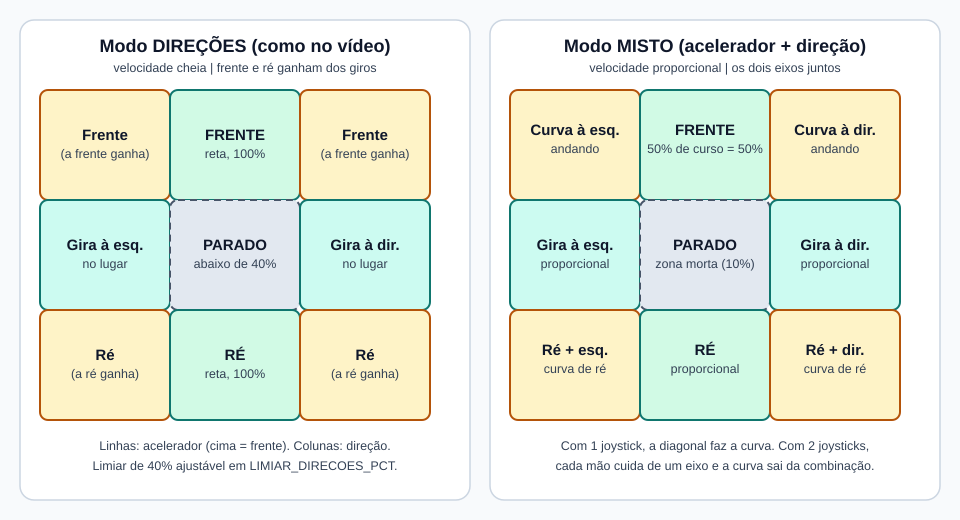
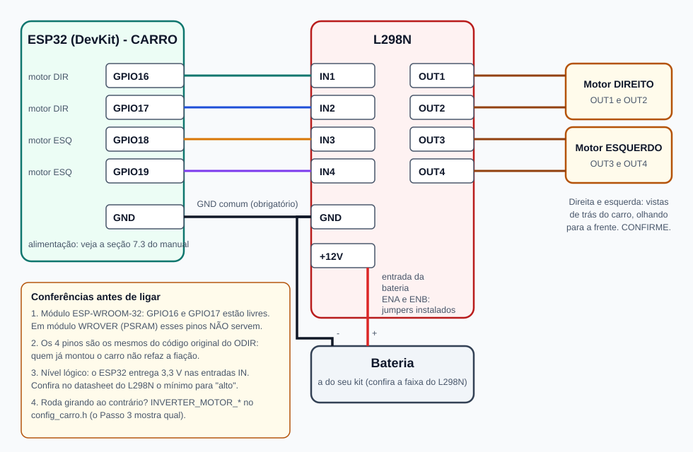
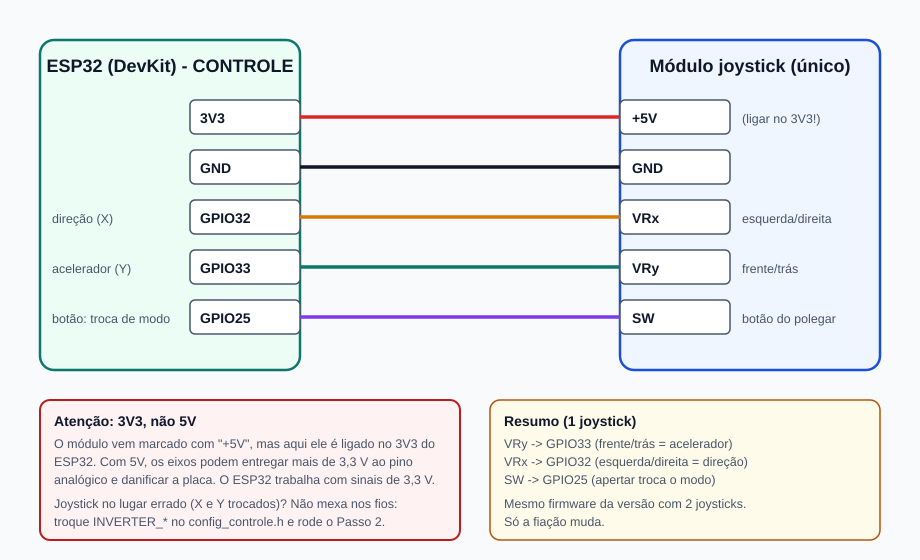
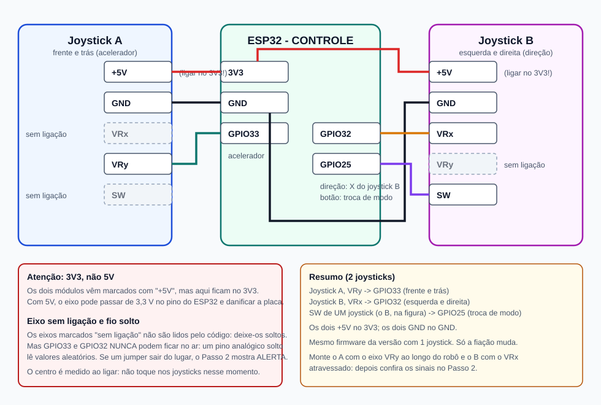

# ODIR ESP-NOW 2.0 — Manual do Tio Rafa

Um carrinho de duas rodas que obedece a um controle com joystick pelo ar, sem roteador, sem celular, sem internet. Duas placas ESP32, uma ponte H e muita vontade de mexer.

**Projeto da edição 19 da Revista Mecatrônica Jovem:** "ODIR com ESP32 e ESP-NOW" (https://tiorafa.tec.br/revista-mecatronica-jovem/)
**Versão do firmware:** 2.0.0
**Placa:** somente **ESP32 clássico** (DevKit com módulo ESP-WROOM-32). Outras famílias (S2, S3, C3, C6) são recusadas de propósito pelo código; veja a seção 6.
**Ambiente:** Arduino IDE, pacote "esp32 by Espressif Systems" (core 2.x ou 3.x)
**Duas montagens de controle, um só código:** 1 joystick (todas as direções) ou 2 joysticks (um para frente e trás, outro para esquerda e direita)

---

## Aviso de honestidade técnica

Leia isto antes de qualquer coisa. Faz parte do jeito Tio Rafa de trabalhar: dizer o que foi verificado e o que não foi.

| Etapa | Situação |
|---|---|
| Revisão do código e da lógica | VALIDADO POR ANÁLISE |
| Testes automáticos no computador (lógica, protocolo, comportamento do carro e do controle, 2 versões do core, com simulação das bibliotecas do ESP32) | VALIDADO POR ANÁLISE e por simulação no computador |
| Compilação com o core Arduino-ESP32 real e gravação em placas | Feitas pelo autor do projeto (Rafael Oliveira), nas suas placas |
| Funcionamento em placas reais | TESTADO EM HARDWARE pelo autor (Rafael Oliveira, informado em 04/11/2026) |

Na prática: o código foi conferido por análise e por simulação no computador, e o autor do projeto testou o carro e o controle em hardware real e informou que funcionam. Detalhe: o autor informa que o projeto foi testado e funciona; os resultados linha a linha não foram enviados ao pacote, então a matriz do manual segue em branco para a sua turma registrar o que observar. A sua montagem pode ter diferenças (placa, joystick, motores, bateria): preencha a tabela de testes (seção 12) e, se algo divergir, abra uma issue no repositório.

Informações que dependem da sua montagem estão marcadas como **CONFIRME NA SUA MONTAGEM**. Não invente ligação: confira a placa que está na sua mesa.

---

## Aviso importante: não tem o kit MonTTudo? Use peças recicladas

O ODIR foi pensado em torno do kit MonTTudo (chassi de MDF cortado a laser, motores amarelos com caixa de redução, ponte H, ESP32). **Se você não tem as peças do kit à mão, não desista e não deixe de fazer o projeto por isso.** Use peças recicladas, em especial:

| Peça do kit | Alternativa reciclada ou do dia a dia |
|---|---|
| Chassi de MDF | Papelão grosso, tampa de caixa de sapato, placa de acrílico, pedaço de MDF de móvel velho, tampa plástica de pote |
| Motores com caixa de redução | Motores de brinquedos quebrados, de impressoras e aparelhos antigos. Descubra a tensão de trabalho antes de ligar (veja abaixo) |
| Rodas | Tampinhas de garrafa, CDs velhos com uma borracha ao redor, rodas de brinquedo |
| Roda boba (apoio da frente) | Uma bolinha de desodorante roll-on, uma tampinha lisa, um pé de móvel de plástico |
| Fios | Cabos de carregadores velhos, fios de rede de computador (par trançado), cabos de impressora |
| Joystick | Joystick de controle de videogame quebrado: por dentro há dois potenciômetros e um botão, exatamente o que o código precisa |
| Suporte de baterias | Qualquer suporte para pilhas, desde que você saiba a tensão total |

Três regras de ouro com sucata:

1. **Meça antes de ligar.** Motor reciclado sem tensão conhecida: comece com uma tensão baixa, confira se esquenta e se o consumo é razoável. Motor grande demais pode passar do que a ponte H aguenta.
2. **Baterias de lítio exigem respeito.** Se você usar células de lítio recicladas (de notebook, por exemplo), nunca use célula inchada, amassada, com a capa rasgada ou que esquenta sozinha. Nunca provoque curto-circuito. Use suporte apropriado e peça ajuda ao professor ou a um adulto que entenda do assunto. Na dúvida, use pilhas comuns.
3. **A eletrônica não negocia.** Sucata vale para a estrutura, para as rodas e para os fios. O ESP32 e a ponte H precisam estar íntegros, e o GND de todos os módulos precisa ser comum.

O espírito do projeto é este mesmo: o ODIR não é um produto fechado, é um convite para fazer com o que você tem. Veja o Interlúdio 2 (seção 3).

---

## Sumário

1. O que você vai construir
2. O que mudou da versão 1 para a 2
3. Interlúdios filosóficos: a máquina aberta e o que está à mão
4. Como funciona (arquitetura e o ESP-NOW)
5. Lista de materiais
6. Preparando a Arduino IDE e escolhendo a placa
7. Montagem e ligações (7.1 carro, 7.2 controle, 7.3 alimentação do carro)
8. Os cinco passos (do mais simples ao projeto completo)
9. Ajustando o comportamento
10. Passeio pelo código
11. Segurança
12. Testes e tabela de resultados
13. Diagnóstico de problemas
14. Desafios para a turma
15. Mais interlúdios filosóficos
16. Referências e créditos

A montagem mecânica (chassi, motores, caixa do controle) está em `PASSO_A_PASSO_MONTAGEM.md`. Tabelas de pinos: `PINAGEM.md`. Formato do pacote de rádio: `PROTOCOLO.md`.

---

## 1. O que você vai construir

Dois aparelhos que conversam entre si:

- **O controle (transmissor):** uma ESP32 ligada a um joystick (ou a dois). Ao ligar, ele mede onde está o centro de cada alavanca. Depois, 50 vezes por segundo, manda ao carro dois números (acelerador e direção) mais o modo de condução escolhido.
- **O carro (receptor):** uma ESP32 ligada a uma ponte H L298N e a dois motores. Ele confere se o pacote é legítimo, mistura os números para cada lado e move as rodas. Se o sinal some, ele para.

A conversa usa o **ESP-NOW**, protocolo da Espressif que deixa placas ESP32 trocarem pacotes pequenos diretamente, sem passar por roteador (seção 4).

**Resultado esperado no final do projeto:**

1. Você liga o carro. Ele fica parado e o Monitor Serial mostra que está esperando o controle.
2. Você liga o controle com os joysticks soltos, no centro. O Monitor Serial mostra o centro medido.
3. O carro passa a mostrar o modo (DIRECOES ou MISTO) e responde ao joystick.
4. Apertando o botão do joystick, o controle troca o modo, e o carro acompanha.
5. Desligando o controle (ou saindo do alcance), o carro **para em menos de meio segundo**.

O **mesmo código** serve para a montagem com 1 joystick e para a com 2 joysticks. O que muda é só quem está ligado em cada pino.



---

## 2. O que mudou da versão 1 para a 2

A versão 1 é o código que aparece no vídeo e na revista, de Ujwal Nandanwar, adaptado por Rafael Oliveira. Ele funciona e ensinou muita gente, e foi a base desta versão (o crédito está no cabeçalho de cada sketch). A versão 2 mantém **os mesmos pinos** (quem já montou o carro não refaz a fiação) e melhora o comportamento.

As observações abaixo vêm da **leitura do código, não de testes em hardware**:

| Assunto | Versão 1 | Versão 2 |
|---|---|---|
| Modo "acelerador + direção" com o joystick no centro | A conta de mapeamento com inteiros deixava os dois motores indo para a frente mesmo com a alavanca solta | Mistura diferencial com números decimais; centro = parado |
| Botão de troca de modo | O carro invertia o modo a cada pacote recebido com o botão apertado, então o modo "piscava" enquanto você segurava | O controle detecta **um** aperto (com debounce) e informa o modo no pacote; o carro só obedece |
| Trabalho dentro do callback do rádio | Acionava motores e imprimia no Serial a cada pacote | O callback só copia o pacote; o `loop()` age em ritmo fixo de 50 Hz |
| Velocidade | Liga/desliga | PWM com rampa de aceleração e freio mais rápido |
| Validação do pacote | Nenhuma | Tamanho, assinatura (magic), versão, checksum e faixa dos valores |
| Perda de sinal | Espera de 1 s para parar | 400 ms (ajustável em `TIMEOUT_SINAL_MS`) |
| Centro do joystick | Valor fixo | Medido ao ligar, com tentativas e aviso se a fiação estiver estranha |
| Zona morta | Faixas fixas | Percentual com reescala linear (sem "degrau" na saída da zona morta) |
| MAC do carro | Escrito direto no código | Em `config_controle.h`; o controle se recusa a iniciar com o MAC zerado |
| Versão do core Arduino-ESP32 | Só 3.x | 2.x e 3.x |
| Chip | Qualquer ESP32 | Só o clássico, com `#error` claro nas outras famílias |

---

## 3. Interlúdios filosóficos: a máquina aberta e o que está à mão

### Interlúdio 1: a máquina aberta

O filósofo francês Gilbert Simondon (1924-1989) fez uma distinção que cabe bem nesta bancada. Uma máquina **fechada** faz uma coisa, do jeito que foi projetada, e nada além. Uma máquina **aberta** deixa uma margem de indeterminação: ela é sensível a informação externa, e por isso pode ser ajustada, combinada, reinventada por quem a usa. Para Simondon, o ser humano que se relaciona bem com as máquinas não é o dono nem o escravo delas, é quem as coordena e as interpreta como um maestro, mantendo-as abertas.

O ODIR é aberto de propósito. Um código, duas montagens de controle. Um arquivo de configuração com tudo que dá para ajustar. Um protocolo documentado que qualquer outra placa pode aprender a falar. Quando você troca um joystick por dois sem mudar uma linha de código, você está praticando, com a mão na massa, aquilo que Simondon chamou de cultura técnica: entender o objeto técnico como parte da cultura, e não como caixa-preta que se compra pronta.

*Para pensar:* o que no seu carro ainda é "caixa-preta" para você? O que você precisaria saber para abri-la?

### Interlúdio 2: o que está à mão

O antropólogo Claude Lévi-Strauss, no *Pensamento selvagem*, descreve o **bricoleur**: quem resolve problemas com o repertório que tem à mão, reaproveitando restos de outras obras, em vez de encomendar material específico para cada projeto. Ele contrasta essa figura com a do engenheiro, que parte de um plano e de peças pensadas para ele. Na prática, quem constrói robôs de verdade costuma ser os dois ao mesmo tempo.

É por isso que este manual insiste tanto nas peças recicladas. O romancista William Gibson escreveu, no conto "Burning Chrome", que "the street finds its own uses for things": a rua encontra usos próprios para as coisas. Um joystick de videogame quebrado vira controle de robô; uma tampinha de garrafa vira roda. Reciclar não é plano B, é uma das formas mais antigas e mais criativas de fazer tecnologia. E tem um benefício extra: a peça que já tem história exige que você a entenda antes de usar.

*Para pensar:* que objeto da sua casa, prestes a ir para o lixo, poderia virar parte do seu ODIR?

### Interlúdio 3: o filho que ensina o pai (ou o contrário)

O nome ODIR é o do pai do professor Rafael: autodidata, leitor das revistas do professor Newton C. Braga, primeiro professor de seu filho. O paulista Paulo Freire escreveu, na *Pedagogia da Autonomia*, que ensinar não é transferir conhecimento, e sim criar as possibilidades para a sua própria produção ou construção. Um kit de robótica que vira revista que vira vídeo que vira projeto de alunos é uma cadeia dessas possibilidades: alguém abre o caminho, outro caminha e, no caminho, reconstrói.

---

## 4. Como funciona (arquitetura e o ESP-NOW)

### 4.1 O que é o ESP-NOW

O ESP-NOW é um protocolo da Espressif (a fabricante do ESP32) para trocar pacotes curtos entre placas **diretamente**, sem roteador e sem internet. Cada pacote pode ter até 250 bytes de dados, e o do ODIR usa apenas 7. A latência é baixa e o consumo é pequeno, o que combina com controle de robôs.

**Correções a duas frases comuns** (inclusive no material de apresentação da versão 1):

- *"Um dispositivo é mestre e o outro é escravo."* Em ESP-NOW **não há papéis obrigatórios** de mestre e escravo: é comunicação ponto a ponto (peer-to-peer), e qualquer placa que cadastre a outra como par pode enviar. Neste projeto, o controle envia e o carro recebe, por escolha de projeto.
- *"A comunicação é criptografada."* O ESP-NOW **permite** criptografia, mas ela é opcional e precisa ser configurada (chaves PMK e LMK). **Neste projeto a criptografia está desligada** (`encrypt = false`). Os pacotes viajam em claro e, com o filtro de remetente desligado (padrão), qualquer controle que fale o protocolo do ODIR pode dirigir o seu carro. Em sala de aula isso tem uma consequência divertida: alguém pode "roubar" o seu carro. A seção 14 propõe, como desafio, ligar a criptografia.

### 4.2 O fluxo, de ponta a ponta

```
joystick (potenciômetros) -> ADC do ESP32 -> média, centro, zona morta -> percentuais -100 a +100
   -> pacote de 7 bytes (acelerador, direção, modo, sequência, checksum)
   -> ESP-NOW (canal 1) ->
   carro: callback copia o pacote -> loop valida -> modo DIRECOES ou MISTO
   -> mistura esquerda/direita -> rampa de aceleração/freio -> PWM nos pinos IN do L298N -> motores
```

Se nenhum pacote **válido** chega por 400 ms, o carro zera o alvo dos motores e o freio rápido para o carro.

### 4.3 Os dois modos de condução

O botão do joystick (GPIO25) alterna entre os modos. O controle decide e informa no pacote; o carro acompanha.



- **DIRECOES** (como no vídeo): quatro movimentos em velocidade cheia. Frente e ré têm prioridade sobre os giros, para evitar o "carro indeciso" quando a alavanca fica na diagonal.
- **MISTO**: acelerador e direção atuam juntos, com velocidade proporcional ao curso. Na prática, é o "dirigir de verdade".

LED azul da placa do carro (se existir): aceso fixo = MISTO; piscando devagar = DIRECOES; piscando rápido = sem sinal.

### 4.4 Por que o carro não faz as contas dentro do callback

O callback do ESP-NOW roda em um contexto do sistema de rádio. Se você gasta tempo ali (imprimindo no Serial, mexendo em motores), pode perder pacotes ou travar outras tarefas. A versão 2 copia o pacote para uma variável protegida por `portMUX` e sai. O `loop()` lê essa cópia no seu próprio ritmo (50 Hz).

---

## 5. Lista de materiais

Veja `hardware/LISTA_DE_MATERIAIS.md`, com a coluna "Alternativa reciclada". Resumo:

**Carro:** 1 ESP32 DevKit (módulo ESP-WROOM-32), 1 ponte H L298N, 2 motores com caixa de redução, chassi, 2 rodas, apoio da frente (roda boba), suporte de baterias, interruptor, fios.

**Controle (1 joystick):** 1 ESP32 DevKit, 1 módulo joystick (eixos VRx e VRy e botão SW), jumpers fêmea-fêmea, alimentação (cabo USB com power bank, ou o que o seu kit usar: CONFIRME NA SUA MONTAGEM).

**Controle (2 joysticks):** 1 ESP32 DevKit, 2 módulos joystick, jumpers, alimentação.

---

## 6. Preparando a Arduino IDE e escolhendo a placa

### 6.1 Instalar o pacote ESP32

1. Arduino IDE: **Arquivo > Preferências**.
2. No campo "URLs adicionais para Gerenciadores de Placas", cole:

```text
https://espressif.github.io/arduino-esp32/package_esp32_index.json
```

3. **Ferramentas > Placa > Gerenciador de Placas**, pesquise "esp32" e instale **esp32 by Espressif Systems**.

O material da versão 1 mostra a URL antiga (`dl.espressif.com`). A documentação atual da Espressif usa a de cima; prefira essa.

### 6.2 Selecionar a placa

Para a maioria das DevKit com módulo ESP-WROOM-32, a escolha é **ESP32 Dev Module**. **CONFIRME NA SUA PLACA**: se a sua placa tem definição própria do fabricante, use a dele.

### 6.3 Por que só o ESP32 clássico

Esta versão foi escrita e conferida para o ESP32 clássico: pinos GPIO16, 17, 18, 19 para os motores, GPIO32, 33 (ADC1) para os eixos e GPIO25 para o botão. Em outras famílias (S2, S3, C3, C6) os pinos e os periféricos mudam, e o código **para de compilar com uma mensagem clara** em vez de falhar de forma misteriosa. Se você quiser outra placa, veja a versão ESP HAND CONTROL do Tio Rafa, que tem suporte ao C3, ou mantenha o seu próprio port seguindo o `PINAGEM.md`.

### 6.4 Pinos livres: WROOM e WROVER

Os pinos GPIO16 e GPIO17 só ficam livres em placas com módulo **ESP-WROOM-32**. Em módulos **ESP32-WROVER** (com PSRAM), esses pinos são usados pela memória. **CONFIRME NA SUA PLACA** lendo a inscrição na lata do módulo.

---

## 7. Montagem e ligações

Faça a parte mecânica seguindo `PASSO_A_PASSO_MONTAGEM.md`. Aqui ficam as ligações elétricas.

### 7.1 Carro: ESP32, L298N e motores



| ESP32 (carro) | L298N | Função |
|---|---|---|
| GPIO16 | IN1 | Motor direito, sentido A |
| GPIO17 | IN2 | Motor direito, sentido B |
| GPIO18 | IN3 | Motor esquerdo, sentido A |
| GPIO19 | IN4 | Motor esquerdo, sentido B |
| GND | GND | Terra comum (obrigatório) |

Detalhes importantes:

- **ENA e ENB:** o código original nunca usava esses pinos; a velocidade da versão 2 vem do **PWM aplicado nos pinos IN**. Por isso os jumpers de ENA e ENB precisam estar **instalados** no módulo L298N. **CONFIRME NA SUA MONTAGEM** (nos diagramas do passo a passo original esse detalhe não pôde ser lido pelo autor deste pacote).
- **Direita e esquerda:** vistas por quem olha o carro por trás, indo para a frente. **CONFIRME NA SUA MONTAGEM**: se os motores estiverem trocados, o Passo 3 mostra qual está em qual lado e você corrige com `INVERTER_MOTOR_ESQ` e `INVERTER_MOTOR_DIR` (sentido) ou trocando os pares de fios.
- **Nível lógico:** o ESP32 entrega 3,3 V nas saídas. O L298N costuma aceitar isso como nível alto, mas **CONFIRME NO DATASHEET do seu módulo**.

### 7.2 Controle: 1 joystick ou 2 joysticks

O módulo joystick é composto por dois potenciômetros (um por eixo) e um botão. O ESP32 mede cada potenciômetro como uma tensão entre 0 V e 3,3 V.

**Regra de ouro: alimente os joysticks com 3V3, nunca com 5V**, mesmo que o módulo esteja escrito "+5V". Com 5V, o eixo pode devolver mais de 3,3 V ao pino do ESP32 e danificá-lo.

**Por que GPIO32 e GPIO33?** Eles pertencem ao conversor ADC1 do ESP32, que continua funcionando com o Wi-Fi/ESP-NOW ligado. O ADC2 (GPIO 0, 2, 4, 12 a 15 e 25 a 27) não funciona enquanto o rádio está ligado. Por isso o GPIO25 é usado apenas como botão digital.

#### Versão com 1 joystick (todas as direções)



| Módulo joystick | ESP32 (controle) |
|---|---|
| +5V (ligar no 3V3) | 3V3 |
| GND | GND |
| VRy (frente/trás) | GPIO33 |
| VRx (esquerda/direita) | GPIO32 |
| SW (botão) | GPIO25 |

#### Versão com 2 joysticks (um para cada eixo)



| Joystick | Fio | ESP32 (controle) |
|---|---|---|
| A (frente e trás) | +5V (ligar no 3V3), GND | 3V3, GND |
| A | VRy | GPIO33 |
| B (esquerda e direita) | +5V (ligar no 3V3), GND | 3V3, GND |
| B | VRx | GPIO32 |
| B (ou A) | SW | GPIO25 |

Os eixos que sobram ("sem ligação") **não são lidos** pelo código: deixe-os soltos. Mas os pinos GPIO32 e GPIO33 **nunca** podem ficar sem fio: um pino analógico solto lê valores aleatórios.

**Orientação dos eixos:** a convenção da versão 1 foi mantida. Valor baixo no eixo do acelerador significa **frente**; valor alto no eixo da direção significa **direita**. Se o seu joystick ficou montado ao contrário na caixa, não mexa nos fios: troque `INVERTER_ACELERADOR` ou `INVERTER_DIRECAO` para `true` no `config_controle.h` e confira no Passo 2.

### 7.3 Alimentação do carro

**INFORMAÇÃO NÃO CONFIRMADA.** O autor deste pacote não conseguiu ler os diagramas de ligação do passo a passo original (as imagens do Drive não puderam ser interpretadas), então não afirma como o ESP32 do carro é alimentado na sua montagem. Há duas formas comuns em carrinhos com L298N; **confirme qual a sua usa**:

| Opção | Como é | Cuidados |
|---|---|---|
| A. ESP32 alimentado pela saída de 5 V do L298N | Fio do pino 5V do L298N ao pino 5V/VIN da ESP32, GND comum | Só vale se o módulo L298N tem o regulador de 5 V ativo (jumper de 5V, conforme o modelo) e a tensão da bateria está na faixa que o seu módulo exige. **CONFIRME NO SEU MÓDULO.** |
| B. ESP32 alimentado por power bank (USB) | Power bank ligado ao USB da ESP32; a bateria dos motores vai só ao L298N | **O GND dos dois sistemas precisa ser comum**; sem isso os sinais não funcionam |

Regras que valem nas duas opções:

- **GND comum** entre ESP32, L298N e bateria.
- Nunca ligue a bateria dos motores diretamente no ESP32.
- Motores geram ruído e quedas de tensão. Se o ESP32 reiniciar quando o carro acelera (o Monitor Serial mostra o boot de novo), o problema é de alimentação, não de código. Veja a seção 13.

---

## 8. Os cinco passos (do mais simples ao projeto completo)

A regra do Tio Rafa: **testar uma coisa por vez**. As cinco pastas em `firmware/` seguem isso. Cada pasta é um sketch independente. Abra o `.ino` de dentro da pasta (a Arduino IDE exige que a pasta tenha o mesmo nome do `.ino`).

Todos os sketches usam o Monitor Serial a **115200 baud**.

### Passo 1: descobrir o MAC do carro

Grave `Passo1_Descobrir_MAC` na **placa do carro**. Abra o Monitor Serial.

**Resultado esperado:** a cada 2 segundos, duas linhas:

```text
MAC (texto)  : AA:BB:CC:DD:EE:FF
MAC (codigo) : {0xAA, 0xBB, 0xCC, 0xDD, 0xEE, 0xFF};
```

Copie a linha **"MAC (codigo)"** e cole em `firmware/comum/config_controle.h`, na constante `MAC_CARRO`. Cada placa tem o seu MAC. Não use o do vídeo nem o de outro carro.

Depois de colar, rode `tools/sincronizar_comum.sh` (ou copie o `config_controle.h` para as pastas `Passo2` e `Passo5`). Se preferir editar só dentro da pasta `Passo5_Controle_Transmissor`, tudo bem: o que importa é que o sketch que você grava tenha o MAC certo.

### Passo 2: testar os joysticks

Grave `Passo2_Teste_Joystick` na placa do **controle**, já montada com 1 ou 2 joysticks.

**Resultado esperado:**

```text
ACEL adc=2050 pct=  +0 | DIR adc=2047 pct=  +0 | botao: solto
```

- Sem tocar: ADC perto de 2048, percentuais perto de 0.
- Empurrando o joystick de frente para o acelerador: o `pct` do acelerador fica **positivo** (frente). Se ficou negativo, mude `INVERTER_ACELERADOR`.
- Empurrando para a direita: o `pct` da direção fica **positivo**. Se não, mude `INVERTER_DIRECAO`.
- Apertando o botão: aparece "apertado".
- Se um eixo ficar preso em 0 ou 4095, o sketch avisa **ALERTA**: fio solto ou joystick ligado em 5V.

Existe uma opção `MODO_PLOTTER` para ver as curvas no Plotter Serial da Arduino IDE.

### Passo 3: testar os motores

**LEVANTE O CARRO** (rodas no ar) e grave `Passo3_Teste_Motores` na placa do carro, com a bateria ligada.

**Resultado esperado:** contagem regressiva de 5 s, depois a sequência: cada motor sozinho para frente e para trás, depois os dois juntos, e uma **rampa de PWM** que mostra a partir de qual valor as rodas **começam** a girar. Anote esse valor e, se for maior que 80, ajuste `PWM_MINIMO` no `config_carro.h`.

Confira com o carro no ar:

- O motor direito é o da direita, vendo o carro por trás? Se não, troque os fios (par OUT1/OUT2 com o par OUT3/OUT4) ou inverta no código.
- Para frente é para frente? Se a roda gira ao contrário, use `INVERTER_MOTOR_ESQ` ou `INVERTER_MOTOR_DIR`.

### Passo 4: carro (receptor)

Grave `Passo4_Carro_Receptor` na placa do carro.

**Resultado esperado (Monitor Serial):**

```text
=== ODIR ESP-NOW 2.0.0 - CARRO | ESP32 classico ===
MAC desta placa: AA:BB:CC:DD:EE:FF (canal 1)
Radio pronto. Aguardando o controle...
[SEM SINAL] ...
```

O MAC impresso tem que ser o que você colou no controle.

### Passo 5: controle (transmissor)

Grave `Passo5_Controle_Transmissor` na placa do controle. **Não toque nos joysticks na hora de ligar:** é nesse momento que o centro é medido.

**Resultado esperado:**

```text
=== ODIR ESP-NOW 2.0.0 - CONTROLE | ESP32 classico ===
Calibrando o centro... NAO toque nos joysticks.
Centro: acel=2048 dir=2046
Controle pronto. Modo: DIRECOES (aperte o botao para trocar).
```

(Os números de centro variam de joystick para joystick.) No carro, o estado muda de `[SEM SINAL]` para `[DIRECOES]` ou `[MISTO]`, e o carro responde ao joystick. Aperte o botão: aparece `>> MODO MISTO` no controle e o carro acompanha.

**Se o MAC ainda estiver zerado**, o controle imprime `ERRO FATAL: MAC_CARRO ainda e 00:00:...` e não inicia. É proposital.

---

## 9. Ajustando o comportamento

Tudo que você pode querer mudar está em dois arquivos: `config_carro.h` e `config_controle.h`. Depois de editar na pasta `firmware/comum/`, rode `tools/sincronizar_comum.sh` para copiar nas pastas dos passos.

| Constante | Arquivo | Padrão | O que faz |
|---|---|---:|---|
| `MAC_CARRO` | controle | zerado | MAC de destino (obrigatório) |
| `INVERTER_ACELERADOR`, `INVERTER_DIRECAO` | controle | false | Corrige joystick montado ao contrário |
| `ZONA_MORTA` | controle | 0,10 | Fração do curso ignorada ao redor do centro |
| `ADC_BORDA_MIN`, `ADC_BORDA_MAX` | controle | 150 e 3950 | Onde o ADC é considerado 100% (o ESP32 satura nas pontas) |
| `AMOSTRAS_POR_LEITURA` | controle | 4 | Média de leituras por eixo para reduzir ruído |
| `CENTRO_MIN_ACEITO`, `CENTRO_MAX_ACEITO` | controle | 1400 e 2700 | Centro fora disso = fiação suspeita |
| `PERIODO_ENVIO_MS` | controle | 20 | 50 pacotes por segundo |
| `MODO_INICIAL_MISTO` | controle | false | Modo ao ligar |
| `PINO_BOTAO` | controle | 25 | Use -1 para controle sem botão |
| `INVERTER_MOTOR_ESQ`, `INVERTER_MOTOR_DIR` | carro | false | Sentido de cada motor |
| `PWM_MINIMO` | carro | 80 | Menor PWM em que a roda gira (Passo 3) |
| `LIMITE_VELOCIDADE_PCT` | carro | 100 | Use 60 nos primeiros testes |
| `PASSO_ACELERAR` | carro | 0,10 | Subida de velocidade por ciclo de 20 ms |
| `PASSO_FREAR` | carro | 0,34 | Queda por ciclo (freio mais firme) |
| `TIMEOUT_SINAL_MS` | carro | 400 | Tempo sem pacote válido até parar |
| `LIMIAR_DIRECOES_PCT` | carro | 40 | Quanto empurrar para valer como direção, no modo DIRECOES |
| `FILTRAR_REMETENTE`, `MAC_CONTROLE_PERMITIDO` | carro | 0 | Aceitar só um controle específico |

Sugestão para a primeira volta: `LIMITE_VELOCIDADE_PCT = 60`. Depois de entender o comportamento, volte para 100.

---

## 10. Passeio pelo código

Estrutura de `firmware/comum/` (cada arquivo tem um papel só):

| Arquivo | Papel |
|---|---|
| `protocolo.h` | O pacote de 7 bytes, o checksum e a validação |
| `logica.h` | Funções puras: normalizar eixo, zona morta, mistura diferencial, rampa, PWM |
| `motores.h` | Classe `MotorPonteH` e camada de compatibilidade do PWM entre core 2.x e 3.x |
| `utilitarios.h` | Serial, LED, piscar |
| `config_carro.h` | Pinos e parâmetros do carro |
| `config_controle.h` | Pinos e parâmetros do controle |

**Ideias que vale a pena ler no código:**

1. **Funções puras em `logica.h`.** Não tocam em hardware, então dá para testar no computador (e é o que a pasta `tools/teste_host/` faz).
2. **Mistura diferencial:** `esquerda = acelerador + direção`, `direita = acelerador - direção`, depois normaliza para não passar de 100%. É a conta que transforma "para onde ir" em "quanto cada roda gira".
3. **Rampa com freio rápido:** acelerar suave poupa bateria e patinagem; frear firme evita o carro "boiar".
4. **Checksum:** um XOR com semente 0x5A sobre os bytes anteriores. Não é segurança, é detecção de pacote corrompido.
5. **Duas assinaturas de callback:** o core 3.x mudou o primeiro parâmetro do callback de recepção. O código detecta a versão com `ESP_ARDUINO_VERSION_MAJOR`.

---

## 11. Segurança

1. **Levante o carro** em todo primeiro teste de motor.
2. **Falha segura:** perda de sinal por 400 ms para os motores. Mesmo assim, mantenha o interruptor da bateria à mão.
3. **Baterias:** veja o aviso sobre lítio na parte de peças recicladas. Nunca em curto, nunca inchada, nunca carregando sem supervisão.
4. **GND comum** e **3V3 nos joysticks.**
5. **Estado seguro ao ligar:** o carro inicia com os motores parados até receber um pacote válido.
6. **Sala com vários carros:** ligue `FILTRAR_REMETENTE` ou acabe com "carro sequestrado" no meio da aula.

---

## 12. Testes e tabela de resultados

### Resultado esperado (resumo)

1. Passo 1 mostra o MAC do carro.
2. Passo 2 mostra o centro perto de 2048 e inversões corretas.
3. Passo 3 gira cada motor no sentido certo e mostra o PWM mínimo.
4. Passo 4 mostra o MAC e "Aguardando o controle".
5. Passo 5 calibra o centro e conecta; o carro obedece e para ao perder o sinal.

### Matriz de testes

Preencha **Resultado real** com o que você observar na sua montagem. A coluna fica em branco de propósito: é o registro da sua turma.

| Teste | Entrada | Ação | Resultado esperado | Resultado real |
|---|---|---|---|---|
| 01 | Ligar o carro (Passo 1) | Abrir Monitor Serial | MAC impresso em texto e em formato de código | |
| 02 | Ligar o controle (Passo 2) | Soltar os joysticks | ADC perto de 2048, percentual perto de 0 | |
| 03 | Eixo do acelerador | Empurrar para frente | Percentual positivo | |
| 04 | Eixo da direção | Empurrar para a direita | Percentual positivo | |
| 05 | Botão | Apertar e soltar | "apertado" ao pressionar, "solto" ao soltar | |
| 06 | Motor direito (Passo 3) | Sequência de teste | Gira no sentido certo, no lado direito | |
| 07 | Motor esquerdo (Passo 3) | Sequência de teste | Gira no sentido certo, no lado esquerdo | |
| 08 | Rampa de PWM (Passo 3) | Observar quando a roda começa a girar | Valor anotado para `PWM_MINIMO` | |
| 09 | Carro (Passo 4) | Ligar sem controle | `[SEM SINAL]`, motores parados | |
| 10 | Controle (Passo 5) | Ligar com joysticks soltos | Centro calibrado; modo inicial exibido | |
| 11 | Conexão | Ligar o controle com o carro ligado | Carro muda para DIRECOES ou MISTO | |
| 12 | Modo DIRECOES | Empurrar para frente, ré, esquerda, direita | Quatro movimentos em velocidade cheia | |
| 13 | Modo MISTO | Empurrar acelerador e direção juntos | Curva proporcional | |
| 14 | Botão no controle | Apertar uma vez | Modo troca **uma** vez | |
| 15 | Perda de sinal | Desligar o controle com o carro andando | Carro para em cerca de 0,4 s | |
| 16 | MAC zerado | Gravar o controle sem colar o MAC | `ERRO FATAL` e não inicia | |
| 17 | Placa errada | Compilar para ESP32-S3 | Erro de compilação explicando "só ESP32 clássico" | |
| 18 | 1 joystick | Todos os testes acima com a fiação de 1 joystick | Mesmos resultados | |
| 19 | 2 joysticks | Todos os testes acima com a fiação de 2 joysticks | Mesmos resultados | |

### Teste de integração

```text
[ ] placa e alimentação        [ ] GND comum
[ ] joystick(s)                [ ] motores e ponte H
[ ] MAC correto                [ ] modos e botão
[ ] failsafe                   [ ] comportamento final
```

Um componente funcionando sozinho não garante o sistema inteiro.

---

## 13. Diagnóstico de problemas

Investigue **de baixo para cima**: a causa costuma estar mais perto da base do que do código.

| Sintoma | Verifique, nesta ordem | Provável causa |
|---|---|---|
| A placa não aparece na porta | Cabo USB (de dados, não só de carga), porta, driver, outra porta | Cabo ruim |
| Erro ao enviar | Placa e porta selecionadas, core instalado, modo de gravação da placa | Placa errada, ou algumas DevKit pedem segurar BOOT na hora do upload (CONFIRME NA SUA PLACA) |
| Erro "só ESP32 clássico" | Placa selecionada em Ferramentas > Placa | Selecionada uma placa S2/S3/C3/C6 |
| Erro de compilação com o callback de recepção | Versão do core (2.x ou 3.x) | Core muito antigo ou muito novo. Registre a versão em uma issue |
| Controle diz `ERRO FATAL: MAC_CARRO` | `config_controle.h` | MAC não colado, ou não sincronizado nas pastas |
| Carro fica em `[SEM SINAL]` | MAC colado é o do carro? Canal? Os dois ligados? | MAC errado; peer não cadastrado; controle desligado |
| Joystick sempre a 0 ou 4095 | Passo 2: ALERTA | Fio solto, GPIO errado ou joystick em 5V |
| Centro "estranho" na calibração | Não tocou nos joysticks? Fiação? | Joystick mexendo ou fio solto; veja `CENTRO_MIN/MAX_ACEITO` |
| Eixo ao contrário | Passo 2 | `INVERTER_ACELERADOR` ou `INVERTER_DIRECAO` |
| Carro anda sozinho com o joystick solto | Zona morta; centro; alimentação do joystick | Joystick velho: aumente `ZONA_MORTA` |
| Motor só "zumbe" | PWM mínimo; bateria fraca | Aumente `PWM_MINIMO` ou troque a bateria |
| Uma roda não gira | Fios do motor; `INx` correspondente; GPIO16/17 | Fio solto; ou módulo WROVER usando GPIO16/17 |
| ESP32 do carro reinicia ao acelerar | Alimentação; bateria; fios finos | Queda de tensão; use power bank separado, ou fios mais grossos |
| Carro continua depois de desligar o controle | `TIMEOUT_SINAL_MS`; versão gravada | Sketch antigo gravado |
| Funciona com 1 joystick e não com 2 | Lista de fios; eixos soltos | Falta GND comum, ou GPIO33/GPIO32 sem fio |

Se tudo isso estiver certo e ainda falhar, anote: modelo da placa, versão do core, mensagem do Monitor Serial, foto da montagem. Com isso uma issue vira um diagnóstico em vez de adivinhação.

---

## 14. Desafios para a turma

1. **Criptografia.** Ligue a criptografia do ESP-NOW: pesquise PMK e LMK na documentação da Espressif, ligue `encrypt` ao cadastrar o par e teste o que acontece quando as chaves não batem.
2. **Segurança prática.** Ative `FILTRAR_REMETENTE` e descubra o MAC do controle com o Passo 1. Um colega consegue "roubar" o seu carro?
3. **Curva de resposta.** O mapeamento do joystick é linear. Troque por uma curva suave (por exemplo quadrática) e compare a sensação de controle.
4. **Telemetria.** O carro pode devolver ao controle o estado da bateria. O ESP-NOW é bidirecional: cadastre o controle como par do carro.
5. **Quatro em um.** O ODIR é "Robótica 4 em 1" (duelo de bexigas, sumô, seguidor de linha etc.). Que sensores e que estado novo você acrescentaria à máquina de estados do carro?
6. **Reciclagem.** Construa o chassi com sucata e documente: o que funcionou, o que não funcionou, peso e consumo.
7. **Documente e compartilhe.** Preencha a matriz de testes, tire fotos e mande para o repositório.

---

## 15. Mais interlúdios filosóficos

### Interlúdio 4: realimentação e controle

Norbert Wiener batizou de cibernética, em 1948, o estudo do controle e da comunicação em animais e máquinas. A ideia central é a **realimentação**: o sistema age, mede o efeito e corrige. O failsafe do carro é uma realimentação em negativo: se o carro não ouve nada, ele concluiu que "ninguém está no comando" e para. Controle remoto confiável não é só sobre mandar comandos, é sobre o que a máquina faz quando eles param de chegar.

### Interlúdio 5: construir para pensar

Seymour Papert, criador da linguagem Logo e parceiro de Piaget, defendia que a criança aprende melhor construindo objetos com os quais pensa, o que ele chamava de "objetos-para-pensar-com". Um carrinho que não anda direito é um objeto desses: o erro vira investigação (será o fio? o centro? o pino?) e a correção vira conhecimento próprio. Este manual tem tabelas de diagnóstico, mas o melhor diagnóstico é o que você descobre sozinho.

### Interlúdio 6: o meio é a mensagem

Marshall McLuhan afirmou que o meio molda a mensagem: o jeito como nos comunicamos muda o que conseguimos dizer. O joystick de dois eixos e o de dois joysticks dizem "esquerda" e "frente" de maneiras diferentes, e as mãos de quem dirige também. Experimente: com 2 joysticks, cada mão cuida de um eixo; com 1 joystick, uma mão resolve tudo. Que montagem faz de você um piloto melhor? Que montagem faz de você um piloto mais confortável?

### Interlúdio 7: tecnodiversidade

Yuk Hui sugere que não existe uma única tecnologia universal, e sim modos diferentes de pensar e fazer técnica, ligados às culturas que os produzem. Um kit de robótica de MDF feito no Brasil, ensinado em escolas técnicas e documentado em português, não é uma versão menor de um kit estrangeiro: é uma forma própria de fazer tecnologia. Documentar e compartilhar o projeto também faz parte dessa diversidade.

---

## 16. Referências e créditos

**Documentação técnica**

- Espressif. *Arduino-ESP32: documentação oficial.* https://docs.espressif.com/projects/arduino-esp32/
- Espressif. *ESP-NOW (ESP-IDF Programming Guide).* https://docs.espressif.com/projects/esp-idf/en/latest/esp32/api-reference/network/esp_now.html
- Pacote Arduino-ESP32 (URL do gerenciador de placas): https://espressif.github.io/arduino-esp32/package_esp32_index.json
- STMicroelectronics. *L298 Dual Full-Bridge Driver* (datasheet).
- Revista Mecatrônica Jovem, edição 19: https://tiorafa.tec.br/revista-mecatronica-jovem/

Observação: confira cada link e cada datasheet antes de publicar; endereços mudam.

**Filosofia e educação**

- DAMASCENO, V. Sobre a ideia de uma cultura Tecno-Estética em Gilbert Simondon. *Revista Interdisciplinar em Cultura e Sociedade*, São Luís, v. 9, n. 1, p. 1-12, jan./jun. 2023.
- FREIRE, P. *Pedagogia da Autonomia: saberes necessários à prática educativa.* São Paulo: Paz e Terra, 1996.
- GIBSON, W. "Burning Chrome" (1982), em *Burning Chrome*.
- HUI, Y. *Tecnodiversidade.* São Paulo: Ubu Editora, 2020.
- LÉVI-STRAUSS, C. *O pensamento selvagem.* Campinas: Papirus. **CONFIRA A EDIÇÃO** e o ano na sua biblioteca antes de citar em trabalho acadêmico.
- MCLUHAN, M. *Understanding Media: The Extensions of Man.* 1964.
- PAPERT, S. *Mindstorms: Children, Computers, and Powerful Ideas.* New York: Basic Books, 1980.
- SIMONDON, G. *Do modo de existência dos objetos técnicos.* Rio de Janeiro: Contraponto, 2020. Tradução de Vera Ribeiro. (Original: *Du mode d'existence des objets techniques*, 1958.)
- VIANA, D. Notas sobre a mentalidade técnica: a intenção pedagógica e a ênfase ativa na filosofia da técnica de Gilbert Simondon. *Revista Filosofia Unisinos*, v. 21, n. 1, p. 79-94, 2020.
- WIENER, N. *Cybernetics: or Control and Communication in the Animal and the Machine.* 1948.

**Créditos**

- Projeto, conceito e kits: Prof. Tio Rafa (Rafael Oliveira), Robótica Paula Souza / CPS.
- Código original (versão 1): Ujwal Nandanwar, adaptado por Rafael Oliveira. A licença do código original é **INFORMAÇÃO NÃO CONFIRMADA**.
- Agradecimentos do projeto original: Prof. Flavio Guimarães, Thiago e Renato Paiotti; Mamute Eletrônica (kit MonTTudo); canal Brincando com Ideias; Instituto NCB (Newton C. Braga); e ODIR, o pai.
- Versão 2.0 reescrita e documentada com apoio de Claude (Anthropic), a ser testada em bancada pela comunidade.

Contato: contato@tiorafa.tec.br | Instagram: @prof.tiorafa
